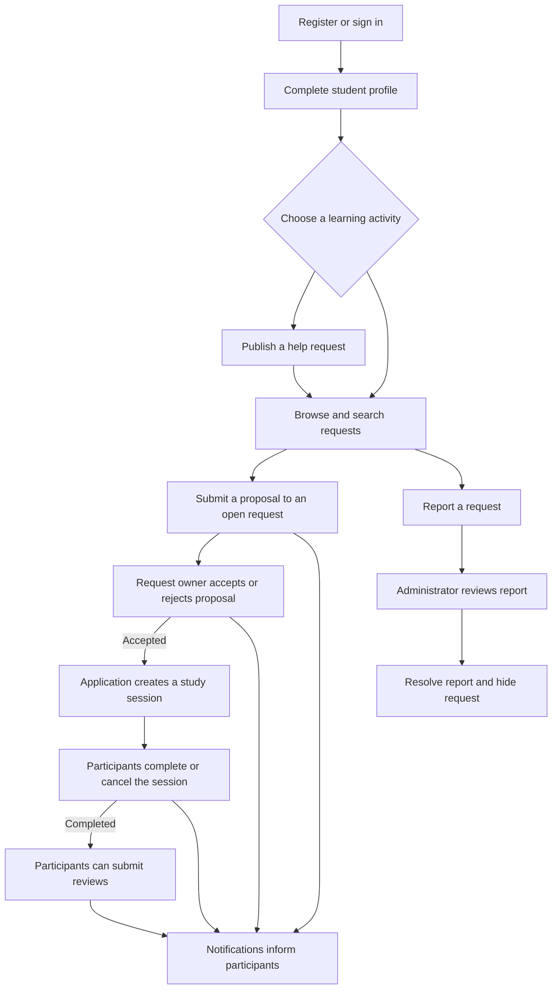
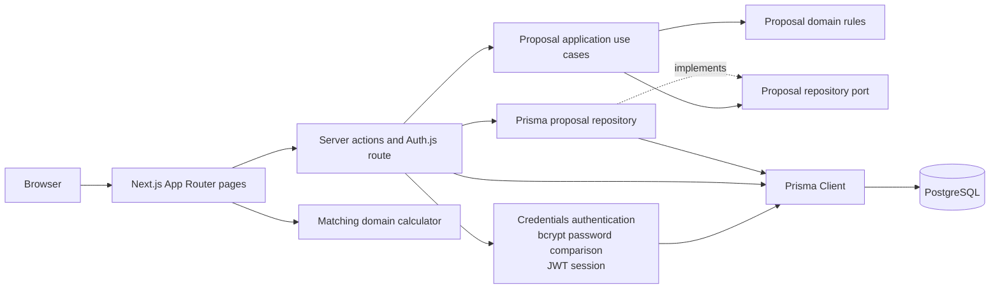
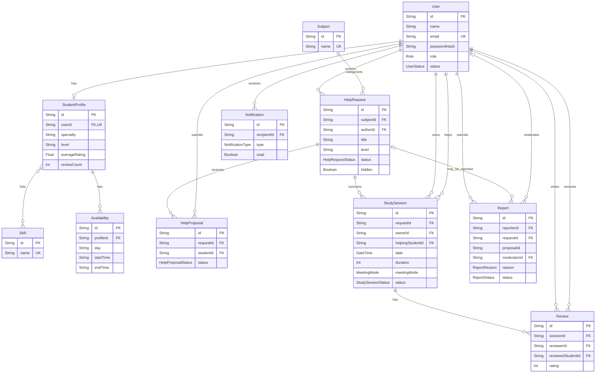

# CampusConnect

CampusConnect is a student-to-student learning support application. Students can publish academic help requests, discover requests from peers, offer help, and follow the resulting study sessions. The project combines a Next.js web application with a PostgreSQL-backed data model and a transparent, rule-based matching feature.

> **Project status:** This README describes the implementation currently present in this repository. Where the interface or data model has limitations, they are identified rather than presented as completed functionality.

## Table of contents

- [Problem statement](#problem-statement)
- [Objectives and intended users](#objectives-and-intended-users)
- [Features and roles](#features-and-roles)
- [Application workflow](#application-workflow)
- [Technology stack](#technology-stack)
- [Architecture](#architecture)
- [Project structure](#project-structure)
- [Data model](#data-model)
- [Important business rules and implementation notes](#important-business-rules-and-implementation-notes)
- [Getting started](#getting-started)
- [Docker setup](#docker-setup)
- [Testing and quality checks](#testing-and-quality-checks)
- [Security](#security)
- [Screenshots](#screenshots)
- [Future improvements](#future-improvements)
- [Academic project information](#academic-project-information)

## Problem statement

Students often rely on informal channels to find help with coursework or to connect with classmates who can explain a topic. It can be difficult to discover who needs help, who is willing to provide it, and whether a study session has been arranged. CampusConnect provides a shared space for those peer-learning activities, with requests, proposals, sessions, reviews, and notifications represented in one application.

## Objectives and intended users

The project aims to:

- Make it straightforward for students to ask for or offer academic help.
- Organize requests by subject and academic level, with keyword search.
- Support a traceable request-to-proposal-to-session workflow.
- Provide profile information and compatibility recommendations to support peer discovery.
- Give administrators basic account and report-moderation controls.

The primary users are **students** looking for peer support or offering their knowledge. **Administrators** oversee user account status and review reports. The application uses a role field to distinguish these users; new registrations default to the student role.

## Features and roles

| Role | Implemented capabilities |
|---|---|
| Student | Register and sign in; edit a profile; publish and browse help requests; search requests by keyword, subject, and level; submit a proposal to an open request; accept or reject proposals on a request they own; view and manage study sessions; submit reviews for completed sessions; report a request; view and mark notifications as read. |
| Administrator | View user and request counts; suspend or reactivate accounts; review pending reports and hide the reported request while resolving a report. |

Other implemented capabilities include:

- A student dashboard with request/proposal counts, upcoming sessions, average rating, and recent notifications.
- Profile fields for specialty, academic level, biography, and skills.
- A rule-based Smart Matching page that ranks active, profiled students for an open request and shows a percentage score and short explanation.
- Request visibility controls used by report moderation.

## Application workflow



In the current implementation, accepting a proposal creates a session automatically with a default date and meeting details; participants do not choose those details in the acceptance flow. See [Important business rules and implementation notes](#important-business-rules-and-implementation-notes).

## Technology stack

| Area | Technologies |
|---|---|
| Web application | Next.js App Router, React, TypeScript |
| Styling and icons | Tailwind CSS, Lucide React |
| Database and ORM | PostgreSQL, Prisma ORM |
| Authentication | Auth.js / NextAuth Credentials provider, JWT sessions, `bcryptjs` |
| Input validation | Zod (used to validate sign-in credentials) |
| Unit testing | Vitest |
| Browser testing | Playwright |
| Containerization | Docker, Docker Compose, PostgreSQL 16 Alpine image |

Versions and scripts are defined in [`package.json`](./package.json), and the PostgreSQL container image is specified in [`docker-compose.yml`](./docker-compose.yml).

## Architecture

The project uses a **feature-oriented, Clean Architecture-inspired structure**, but the separation is applied selectively rather than uniformly across every feature.

- The proposal workflow has a domain layer for proposal rules, an application layer for use cases and repository ports, and an infrastructure adapter backed by Prisma.
- The matching score calculator is framework-independent domain logic.
- Next.js App Router pages and server actions provide the presentation layer. Several page actions access Prisma directly rather than going through application use cases.
- Prisma maps application data to PostgreSQL using the schema in [`prisma/schema.prisma`](./prisma/schema.prisma).



The diagram distinguishes the proposal use-case path from page/server-action code that directly uses Prisma. Authentication checks credentials against stored password hashes; the application data layer uses Prisma to persist users, requests, proposals, sessions, reviews, reports, and notifications.

## Project structure

```text
.
├── prisma/
│   ├── migrations/              # Committed PostgreSQL migration history
│   ├── schema.prisma            # Database models, enums, and relations
│   └── seed.ts                  # Development sample data
├── src/
│   ├── app/
│   │   ├── (admin)/             # Administrator pages
│   │   ├── (auth)/              # Login and registration pages
│   │   ├── (student)/           # Dashboard and student workflows
│   │   ├── api/auth/            # Auth.js route handler
│   │   └── page.tsx             # Public landing page
│   ├── components/layout/       # Shared application shell and navigation
│   ├── lib/                     # Authentication and Prisma client setup
│   ├── modules/
│   │   ├── matching/domain/     # Compatibility score calculation
│   │   └── proposals/           # Domain, use cases, ports, Prisma adapter
│   └── types/                   # NextAuth session type augmentation
├── tests/
│   ├── e2e/                     # Playwright browser smoke tests
│   └── unit/                    # Proposal rule and use-case tests
├── docker-compose.yml
├── Dockerfile
└── package.json
```

## Data model

The following entities and relationships are derived from the current Prisma schema. Prisma's implicit many-to-many relation between `StudentProfile` and `Skill` is represented without exposing its generated join table.



### Entity summary

| Entity | Purpose |
|---|---|
| `User` | Identity, unique email, password hash, role, and account status. |
| `StudentProfile` | Optional one-to-one profile with specialty, level, biography, skills, availability records, and cached rating statistics. |
| `Skill` | Reusable skill label connected to student profiles. |
| `Availability` | Day and time range associated with a student profile. |
| `Subject` | Reusable subject category for help requests. |
| `HelpRequest` | A student's request for academic support, with status and a moderation visibility flag. |
| `HelpProposal` | A student's response to a request; a request/student pair is unique. |
| `StudySession` | Session associated with a request, its owner, and the helping student. |
| `Review` | Rating and comment from one session participant about the other. |
| `Report` | Moderation report, optionally associated with a request, with reason and resolution status. |
| `Notification` | Per-user activity message with a read flag. |

`Report.proposalId` is currently a scalar field; the Prisma schema does not declare a relation or foreign key from it to `HelpProposal`. The user and request relations shown above are the relations explicitly declared in the schema.

## Important business rules and implementation notes

- New accounts are students with `ACTIVE` status. Registration requires a name of at least two characters and a password of at least six characters; email is stored in lowercase.
- Only active users can authenticate through the credentials flow.
- A student cannot propose help on their own request. Proposals can be submitted only while a request is `OPEN`.
- The request owner alone can accept or reject a proposal, and only pending proposals can be acted on. The database enforces at most one proposal for a given request/student pair, including after a proposal is rejected.
- Accepting a proposal is transactional: it accepts the chosen proposal, rejects other pending proposals for that request, changes the request to `HELP_ACCEPTED`, creates a study session, and creates notifications.
- The generated session currently defaults to one day after acceptance, 60 minutes, and online mode with a fixed meeting URL. The acceptance interface does not currently collect scheduling or meeting details.
- A participant may complete or cancel a scheduled session. Completing it also marks the associated request `COMPLETED`; cancellation changes the session status but does not reopen the request.
- Reviews are presented for completed sessions. A database uniqueness constraint prevents duplicate reviews for the same session/reviewer/reviewed-student combination. Submitting a review updates the reviewed student's aggregate rating and review count.
- Administrators can suspend or reactivate accounts. Account status is checked during credentials authentication; the code does not show a separate email-verification or password-reset flow.
- Resolving a pending request report hides the associated request and marks the report resolved in a transaction.
- The Smart Matching calculator combines skill overlap (40%), specialty (20%), level (15%), availability (15%), and rating (10%). However, the current matching page passes an empty list of required skills, so the skill-overlap contribution is zero in that screen. Availability overlap is based on exact string comparison, while request availability is free text.

## Getting started

### Prerequisites

- Node.js 22 (the version used by the project Dockerfile) and npm.
- PostgreSQL 16 or a compatible PostgreSQL server, unless using Docker Compose.
- Git.

### Local development

1. Clone the repository and enter the project directory.
2. Create a local environment file:

   ```bash
   cp .env.example .env
   ```

3. Edit `.env` and set `DATABASE_URL` to a reachable PostgreSQL database. Set strong, unique values for `AUTH_SECRET` and `NEXTAUTH_SECRET`; set `NEXTAUTH_URL` to the local application URL.
4. Install dependencies:

   ```bash
   npm ci
   ```

5. Apply the committed database migrations:

   ```bash
   npx prisma migrate deploy
   ```

6. (Optional) Create development sample records:

   ```bash
   npm run db:seed
   ```

   **Warning:** the seed script deletes existing application records before inserting its sample data. Do not run it against a database containing data you need.

7. Start the development server and open [http://localhost:3000](http://localhost:3000):

   ```bash
   npm run dev
   ```

For schema development, `npm run db:migrate` runs `prisma migrate dev`. `npm run db:generate` regenerates the Prisma client after schema changes. The seed script and sample accounts are for local development only.

### Environment variables

| Variable | Purpose |
|---|---|
| `DATABASE_URL` | PostgreSQL connection string used by Prisma. |
| `AUTH_SECRET` | Secret used by Auth.js to protect authentication state. |
| `NEXTAUTH_SECRET` | Authentication secret also included in the environment template and Docker Compose configuration. |
| `NEXTAUTH_URL` | Canonical application URL; local development uses `http://localhost:3000`. |

Use the placeholder values in [`.env.example`](./.env.example) only as a template. Never commit real credentials or use development secrets in a deployed environment.

## Docker setup

The existing [`docker-compose.yml`](./docker-compose.yml) starts both PostgreSQL and the web application. PostgreSQL uses a persistent named volume, and the app waits for the database health check before starting. The container command applies committed Prisma migrations before serving the app.

1. Copy the environment template and replace the authentication secret values with strong local secrets:

   ```bash
   cp .env.example .env
   ```

   Compose supplies development defaults for PostgreSQL settings when they are not set. Override `POSTGRES_USER`, `POSTGRES_PASSWORD`, and `POSTGRES_DB` in `.env` if desired; the application container receives a database URL using the Compose service hostname.

2. Build and start the services:

   ```bash
   docker compose up --build
   ```

3. Open [http://localhost:3000](http://localhost:3000). PostgreSQL is exposed on port `5432`.
4. Stop the services with `Ctrl+C`, or run:

   ```bash
   docker compose down
   ```

The database volume remains after `docker compose down`. Adding `-v` removes the persisted database data. The Compose defaults are for local development only; replace them before any non-local deployment.

To run only PostgreSQL in Docker and run Next.js on the host, start the database with `docker compose up -d postgres`, then configure the host-side `DATABASE_URL` in `.env` and follow the local development steps above.

## Testing and quality checks

Run the checks defined in [`package.json`](./package.json):

```bash
npm run typecheck
npm run lint
npm test
```

The Vitest suite covers proposal business rules and the matching calculator. Playwright smoke tests cover the public landing page, sign-in navigation, and mobile viewport overflow:

```bash
npx playwright install chromium
npm run test:e2e
```

The Playwright configuration starts the Next.js development server when needed. A production build can be checked with:

```bash
npm run build
```

## Security

Security-related measures present in the implementation include:

- Passwords are stored as bcrypt hashes; registration uses a work factor of 12.
- The credentials provider validates email and password input with a Zod schema, normalizes email for lookup, and compares submitted passwords with the stored hash.
- JWT-based Auth.js sessions carry the authenticated user ID and role.
- Suspended users are rejected by the credentials authorization flow.
- The administrator page and its account/moderation actions check the authenticated administrator role on the server.
- Proposal use cases enforce self-proposal, request-state, proposal-state, and ownership rules. Session actions check that the caller is a participant before allowing completion or cancellation.
- Prisma schema constraints enforce unique user emails, unique request/student proposals, unique reviews per session and participant pair, and related foreign-key integrity.
- Authentication secrets and the database URL are configured through environment variables rather than source-controlled runtime configuration.

This is a university/project application, not a hardened public service. The repository does not implement email verification, password recovery, or visible rate limiting for authentication. Use unique secrets, protect the database, and review deployment settings before exposing an instance publicly.

## Screenshots

No application screenshots are currently committed to the repository. No image is included here in place of a verified screenshot.

## Future improvements

The following are recommendations, not features claimed as complete:

- Allow students to manage availability and provide structured required skills on requests; use those values in Smart Matching.
- Compare availability using structured time data rather than free-text equality.
- Let request owners and helpers choose session time, duration, meeting mode, and meeting details during scheduling.
- Expand moderation to support additional report targets and clearer moderator outcomes.
- Add email verification, password recovery, and authentication rate limiting before broader deployment.
- Add broader integration tests for database transactions, roles, reports, and session lifecycle.

## Academic project information

CampusConnect offers material for discussing full-stack application design, role-aware workflows, relational data modeling, authentication, testing, and architectural separation. The repository does not identify a course, institution, supervisor, semester, or complete team attribution; no such details are inferred here. For a formal submission, use the information supplied by the course or project team.
